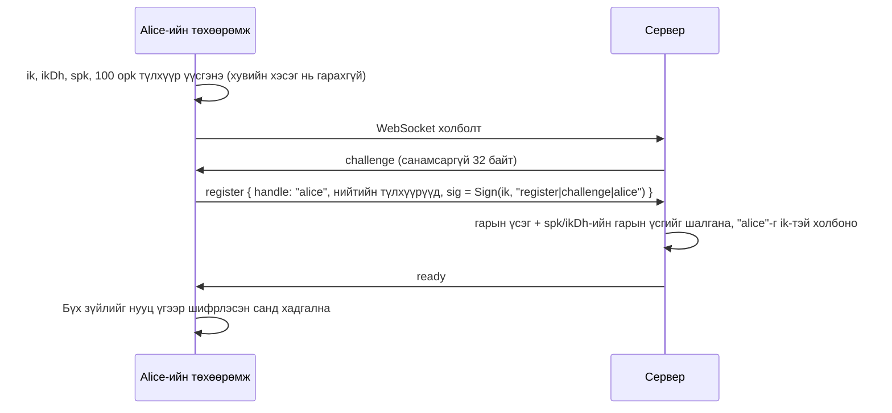
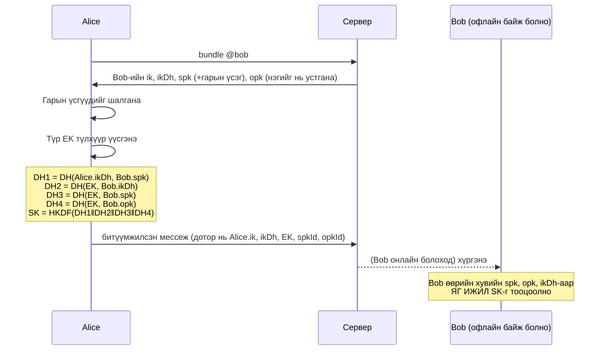

# SHIVNEE хэрхэн ажилладаг вэ

Энэ баримт SHIVNEE-ийн төгсгөлөөс төгсгөл хүртэлх шифрлэлт (E2EE) **яг ямар урсгалаар** явдгийг
алхам алхмаар тайлбарлана. Код дээрх нэрс (`x3dhInitiate`, `ratchetEncrypt` г.м.) нь
[`shared/e2ee.ts`](../shared/e2ee.ts) файлд байгаа функцуудтай шууд таарна.

---

## 0. Хамгийн чухал санаа (нэг догол мөрөөр)

> **Нууц түлхүүрийг хэзээ ч солилцдоггүй.** Хүн бүр *хос* түлхүүртэй: **нийтийн түлхүүр** (хэнд ч
> өгч болно, сервер ч хадгална) ба **хувийн түлхүүр** (төхөөрөмжөөс хэзээ ч гардаггүй). Хоёр хүн
> зөвхөн *нийтийн* түлхүүрээ солилцоод, тус бүрдээ өөрийн хувийн түлхүүрээр **яг ижил нууц тоог
> тооцоолж гаргадаг** (Diffie-Hellman). Энэ нууц тоо хэзээ ч сүлжээгээр дамждаггүй. Дараа нь
> **мессеж бүр шинэ түлхүүрээр** шифрлэгдэж, хуучин түлхүүрүүд устдаг.

Тиймээс "түлхүүрийг алдаж, бусдад өгч болохгүй" гэдэг нь **хувийн түлхүүрийн** тухай зөв ойлголт.
Нийтийн түлхүүрийг бусдад өгөх нь хэвийн, зайлшгүй хэрэгтэй алхам.

---

## 1. Түлхүүрүүдийн жагсаалт

| Түлхүүр | Төрөл | Хаана байдаг | Сервер мэдэх үү? | Зорилго |
|---|---|---|---|---|
| **Identity key** (`ik`) | Ed25519 | Төхөөрөмж (сан дотор) | Зөвхөн *нийтийн* хэсэг | "Би бол @alice" гэдгийг гарын үсгээр батлах |
| **Identity DH key** (`ikDh`) | X25519 | Төхөөрөмж | Зөвхөн нийтийн | Түлхүүр тохиролцоо + битүүмжлэл (sealed sender) |
| **Signed prekey** (`spk`) | X25519, `ik`-ээр гарын үсэг зурсан | Төхөөрөмж | Нийтийн | Таныг офлайн байхад ч хэн нэгэн яриа эхлүүлэх боломж |
| **One-time prekeys** (`opk`, 100 ширхэг) | X25519 | Төхөөрөмж | Нийтийн | Нэг удаа хэрэглэгдээд устна → нэмэлт хамгаалалт |
| **Ratchet keys** | X25519, байнга шинэчлэгдэнэ | Төхөөрөмж | Үгүй | Хариу бүрт шинэ нууц үүсгэх |
| **Message keys** | 32 байт, мессеж бүрт нэг | Төхөөрөмж (түр) | Үгүй | Тухайн нэг мессежийг AES-256-GCM-ээр шифрлэх |
| **Vault key** | AES-256, нууц үгээс гаргана | Санах ойд л (хадгалагдахгүй) | Үгүй | Төхөөрөмж дээрх бүх өгөгдлийг шифрлэх |

---

## 2. Алхам 1 — Бүртгүүлэх (Create identity)



* Код: `UnlockScreen.tsx` → `generateIdentity()`, `generateSignedPreKey()`, `generateOneTimePreKeys()`,
  `registerAccount()`.
* **Нууц үг серверт огт очдоггүй.** Нууц үг зөвхөн төхөөрөмж дээрх санг түгжинэ.
* Хэрэглэгчийн нэр (`@alice`) нь identity key-тэй холбогдоно. Өөр хүн тэр нэрийг авах боломжгүй.

## 3. Алхам 2 — Нэвтрэх (нууц үггүй)

Дараагийн удаа холбогдохдоо сервер шинэ `challenge` илгээнэ. Клиент `Sign(ik, "auth|challenge|alice")`
гэж гарын үсэг зурж буцаана. Сервер өмнө хадгалсан нийтийн түлхүүрээр шалгана. **Серверт ямар ч нууц
үг, токен хадгалагддаггүй.** Хэрэв сервер хакердагдсан ч таны нэрээр нэвтрэх боломжгүй.

## 4. Алхам 3 — Харилцагч нэмэх

1. Alice `@bob` гэж хайна → сервер Bob-ийн **нийтийн** `ik`-г буцаана (`identity` хүсэлт).
2. Alice-ийн төхөөрөмж **аюулгүйн дугаар** тооцоолно: `SHA-256(Alice.ik, Bob.ik)` → 60 оронтой тоо.
3. Bob ч яг ижил тоог харна. Хэрэв хоёулаа уулзаад (эсвэл өөр итгэлтэй сувгаар) тоогоо
   харьцуулж, **таарвал** дундуур хэн ч (сервер ч) түлхүүр сольж хуураагүй гэсэн үг.

> Сервер муу санаатай бол "энэ бол Bob-ийн түлхүүр" гээд өөрийн түлхүүрийг өгч болно (man-in-the-middle).
> Аюулгүйн дугаарыг шалгах нь **үүнийг илрүүлэх цорын ганц арга**. Тиймээс апп шалгагдаагүй
> хүмүүсийг ⚠ тэмдгээр харуулдаг.

## 5. Алхам 4 — Эхний мессеж: X3DH түлхүүр тохиролцоо



* Код: `x3dhInitiate()` (Alice), `x3dhRespond()` (Bob).
* **SK хэзээ ч сүлжээгээр дамждаггүй** — хоёр тал тус тусдаа тооцоолж ижил үр дүн гаргана.
  Энэ бол Diffie-Hellman-ийн "ид шид": `DH(a, B) = DH(b, A)`.
* Bob офлайн байсан ч Alice мессеж илгээж чадна — тиймээс prekey-үүд сервер дээр урьдчилан байрладаг.
* One-time prekey нэг л удаа хэрэглэгдээд Bob-ийн төхөөрөмжөөс устна.

## 6. Алхам 5 — Харилцаа: Double Ratchet

SK-аас эхлээд хоёр "ratchet" (зөвхөн нэг чиглэлд эргэдэг араа) ажиллана:

```
             ┌─────────── DH ratchet (хариу ирэх бүрт эргэнэ) ───────────┐
Root key ──► │ RK₁ ──► RK₂ ──► RK₃ ...                                   │
             └──┬───────┬───────┬────────────────────────────────────────┘
                ▼       ▼       ▼
         Chain key  Chain key  Chain key   ← symmetric ratchet (мессеж бүрт эргэнэ)
           │ │ │
           ▼ ▼ ▼
          MK₁ MK₂ MK₃   ← мессеж бүрт тусдаа түлхүүр, хэрэглэсний дараа устна
```

* **Мессеж бүр шинэ түлхүүртэй** (`kdfCK`) — ижил текстийг хоёр удаа илгээхэд шифр нь өөр байна.
* **Хариу ирэх бүрт** хоёр тал шинэ X25519 түлхүүр үүсгэж, шинэ DH хийнэ (`ratchetDecrypt` дотор
  "DH ratchet step"). Апп дээр "Ratchet алхам" гэж харагддаг тоо энэ.
* Үр дүн:
  * **Forward secrecy** — өнөөдрийн түлхүүр алдагдсан ч *өмнөх* мессежүүдийг тайлж чадахгүй
    (тэдний түлхүүр аль хэдийн устсан).
  * **Post-compromise security** — хэн нэгэн түлхүүр хулгайлсан ч дараагийн хариу ирэхэд шинэ DH
    хийгдэж, хулгайч дахиад "сохорно".
* Мессеж буруу дарааллаар ирвэл алгассан түлхүүрүүдийг түр хадгалж тайлна (1000 хүртэл).
* Мессежийг өөрчилбөл AES-GCM баталгаажуулалт бүтэлгүйтэж, **татгалзана**.
  Нэг мессежийг дахин илгээвэл (replay) түлхүүр нь устсан тул тайлагдахгүй.

## 7. Алхам 6 — Битүүмжилсэн илгээгч (Sealed sender)

Ratchet-ээр шифрлэсэн мессежийг дахиад нэг давхар дугтуйнд хийнэ:

```
seal(Bob.ikDh, { from: "alice", ik, x3dh?, header, ct })
   = нэг удаагийн түлхүүр E + AES-GCM( DH(E, Bob.ikDh) )
```

Сервер **зөвхөн** "энэ дугтуй @bob руу" гэдгийг мэднэ. **Хэн илгээснийг мэдэхгүй.**
Дугтуйг онгойлгосны дараа Bob илгээгчийн нэр ↔ түлхүүрийг сервертэй тулгаж шалгана (хуурамч бол хаяна).

### Сервер дээр яг юу хадгалагддаг вэ? (жинхэнэ `server/data/store.json`-ээс)

```jsonc
{
  "users": {
    "alice": { "ik": "…", "ikDh": "…", "ikDhSig": "…", "spk": { "id": 1, "pub": "…", "sig": "…" },
               "opks": [ /* нийтийн хэсгүүд */ ], "createdAt": 1793... }
  },
  "mail": {
    "bob": [ { "id": "…", "ts": 1793..., "body": "GgRANBNpj06UzeJ7P33…" } ]   // ← илгээгч, текст алга
  }
}
```

Тест дээр бид энэ файлд "hello", "Alice" гэх мэт үг огт байхгүйг шалгасан.

## 8. Хүлээн авах урсгал

```
сервер ──msg──► unseal (ikDh) ──► session байна уу? ── тийм ──► ratchetDecrypt
                                       │ үгүй / таарахгүй
                                       ▼
                                 x3dhRespond → шинэ session → ratchetDecrypt
                                       │
                илгээгчийн нэр ↔ түлхүүрийг сервертэй тулгах (хуурамч бол хаях)
                                       │
                 UI-д харуулах ──► САНД ХАДГАЛАХ ──► серверт "ack" ──► сервер устгана
```

* Код: `src/net/engine.ts` → `receive()`.
* **Эхлээд санд хадгалаад, дараа нь ack** илгээдэг. Тиймээс тэр агшинд хөтөч хаагдсан ч мессеж алдагдахгүй
  (сервер дахин хүргэнэ). Илгээх үед ч ашигласан түлхүүрээ хадгалсны дараа л илгээнэ.
* Хүргэгдсэн / уншсан мэдэгдэл, "бичиж байна…", өөрөө устах хугацаа, профайл (нэр, зураг) —
  **бүгд ижил шифрлэгдсэн сувгаар** явдаг. Сервер эдгээрийг ялгаж ч чадахгүй.

## 9. Бүлэг

Бүлгийн мессежийг **гишүүн бүрт тусад нь** (өөрийн хос ratchet-аар) шифрлэж илгээнэ ("client-side
fan-out"). Бүлгийн нэр, гишүүдийн жагсаалт ч мөн шифрлэгдсэн мессежээр тараагдана.

* Сервер бүлэг байгааг ч, гишүүдийг ч мэдэхгүй — зүгээр л хэд хэдэн дугтуй хардаг.
* Гишүүн хасагдвал түүн рүү дахиж илгээхээ болино → шинэ мессежийг уншиж чадахгүй.
* "Бүх гишүүнтэй түлхүүр шинэчлэх" нь гишүүн бүртэй session-оо устгаж, шинэ X3DH эхлүүлнэ.

## 10. Төхөөрөмж дээрх хадгалалт (сан)

```
нууц үг ──PBKDF2-SHA-256 (310 000 давталт, давс)──► vault key ──AES-256-GCM──► localStorage
```

* Хувийн түлхүүрүүд, session-ууд, мессеж, харилцагч — **бүгд** энэ шифрлэгдсэн блок дотор.
* Буруу нууц үгээр GCM баталгаажуулалт бүтэлгүйтэж, юу ч нээгдэхгүй.
* Нууц үг солих → шинэ давс, шинэ түлхүүрээр дахин шифрлэнэ.

---

## 11. "Түлхүүр алдвал / бусдад өгвөл" яах вэ?

| Нөхцөл | Юу болох вэ | Хамгаалалт |
|---|---|---|
| **Нийтийн түлхүүрээ хэн нэгэнд өгсөн** | Юу ч болохгүй — зориулалт нь тэр | — |
| **Нууц үгээ мартсан** | Сангаа нээж чадахгүй → хуучин мессеж, түлхүүр **үүрд алга** | Хэн ч (бид ч) сэргээж чадахгүй. Шинэ таних тэмдэг үүсгэнэ |
| **Төхөөрөмжөө алдсан (түгжээтэй)** | Хулгайч зөвхөн шифрлэгдсэн блок олно | Хүчтэй нууц үг + автоматаар түгжих |
| **Хувийн identity key хулгайлагдсан** | Хулгайч таны нэрээр шинэ яриа эхлүүлж, нэвтэрч чадна | Санг устгаж шинэ таних тэмдэг үүсгэнэ → бусад "аюулгүйн дугаар өөрчлөгдсөн" анхааруулга харна |
| **Нэг мессежийн түлхүүр алдагдсан** | Зөвхөн тэр **нэг** мессеж | Бусад мессеж өөр түлхүүртэй |
| **Тухайн үеийн ratchet түлхүүр алдагдсан** | Дараагийн хариу хүртэлх мессежүүд | Хариу ирэхэд шинэ DH → хулгайч дахин сохорно |
| **Сервер хакердагдсан** | Хэн хэнд хэзээ илгээснийг (хүлээн авагч, цаг) харж болно; **агуулгыг харж чадахгүй** | Sealed sender: илгээгч ч нуугдсан |
| **Сервер хуурамч түлхүүр өгсөн (MITM)** | Аюулгүйн дугаар **таарахгүй** болно | Чухал хүмүүстэйгээ дугаараа заавал харьцуулах |

---

## 12. Одоогийн хязгаарлалт (шударгаар)

* **Нэг бүртгэл = нэг төхөөрөмж/хөтөч.** Өөр газар нэвтэрвэл өмнөх нь түр зогсоно.
* **Мета өгөгдөл:** сервер хүлээн авагч, цаг, IP хаягийг харна (агуулга, илгээгчийг биш).
* **PBKDF2** ашиглаж байна. Ирээдүйд Argon2id (WebAssembly) руу шилжих нь илүү хүчтэй.
* **Signed prekey автоматаар солигдохгүй** (Signal 1–4 долоо хоног тутам солидог).
* **Бүлгийн гишүүнчлэл** криптографаар хамгаалагдаагүй — гишүүн бүр шинэчлэл илгээж чадна (MLS шиг биш).
* **Хавсралт** 0.5 MB хүртэл, мессеж дотроо шууд явна (Cloudflare-ийн WebSocket нэг фрейм 1 MiB хүртэл).
* **Вэб апп-ын итгэлцэл:** вэб хуудсыг сервер илгээдэг тул серверээ өөрөө ажиллуулах нь хамгийн найдвартай.
* Энэ код **аудит хийгдээгүй**. Анхан шатны үйлдлүүд (X25519, Ed25519, AES-GCM, HKDF) нь аудит
  хийгдсэн `@noble` сангуудаас ирдэг.

---

## 13. Ажиллуулах

```bash
npm install
npm run dev        # сервер (8787) + вэб апп (5173) зэрэг асна
npm test           # протоколын 9 шалгалт
npm start          # build хийгээд бүгдийг 8787 порт дээрээс ажиллуулна
npm run cf:dev     # Cloudflare хувилбарыг локалаар ажиллуулна
npm run deploy     # Cloudflare руу байршуулна (docs/DEPLOY.md)
```

Хоёр хэрэглэгчээр турших: нэг энгийн цонх + нэг **incognito** цонх (тус бүр өөрийн сантай) нээгээд,
хоёр өөр нэрээр бүртгүүлж, нэгнийгээ "Харилцагч нэмэх"-ээр олоорой.
Нэг сүлжээн дэх өөр компьютер: `http://<таны-IP>:5173` (сервер 8787 порт нээлттэй байх ёстой).

## 14. Код хаана байна

| Файл | Юу хийдэг |
|---|---|
| `shared/e2ee.ts` | Түлхүүр, X3DH, Double Ratchet, sealed sender, аюулгүйн дугаар |
| `shared/protocol.ts` | Сүлжээгээр дамжих мессежийн төрлүүд (сервер харах / харахгүй хэсэг) |
| `server/relay.ts` | Relay-ийн дүрэм: challenge нэвтрэлт, prekey лавлах, дугтуй дамжуулах (хоёр хувилбарт нийтлэг) |
| `server/index.ts` | Node дээрх relay (HTTP + WebSocket) |
| `cloudflare/worker.ts` | Cloudflare Worker + Durable Object (SQLite) дээрх relay |
| `server/store.ts` | Серверийн хадгалалт (нийтийн түлхүүр + шифрлэгдсэн дугтуй) |
| `src/net/connection.ts` | WebSocket, гарын үсгээр нэвтрэх, дахин холбогдох |
| `src/net/engine.ts` | Шифрлэх/тайлах, session, бүлгийн fan-out, хүргэлт |
| `src/lib/vault.ts` | Төхөөрөмж дээрх шифрлэгдсэн сан |
| `tests/e2ee.test.ts` | Протоколын шалгалтууд |
